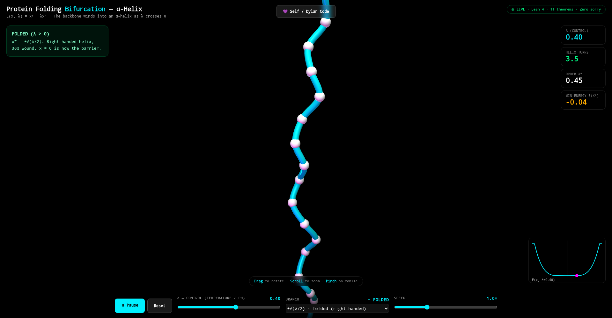

<!-- SPDX-License-Identifier: LicenseRef-Sovereign-Leviathan-SL-AGPL3-001 -->
<!-- Copyright (c) 2026 Ahmad Ali Parr. All rights reserved. -->
<!-- Authored by Ahmad Ali Parr. -->



*Live 3D α-helix visualizer from [`protein-folding-bifurcation`](https://github.com/AHMADALIPARR/protein-folding-bifurcation) — λ = 0.40, FOLDED, 36% wound. This repo proves the invariant behind that visualization.*

# Bifurcation Invariant Verify

**The protein folding bifurcation invariant — proved in Lean, checked in Alloy, drawn in Agda, refined in Liquid Haskell, purified in Curry-Howard.**

[](https://leanprover.github.io/)
[](https://github.com/leanprover-community/mathlib4)
[](https://alloytools.org/)
[](https://wiki.portal.chalmers.se/agda/pmwiki.php)
[](https://github.com/ucsd-progsys/liquidhaskell)
[](https://en.wikipedia.org/wiki/Curry%E2%80%93Howard_correspondence)
[](LICENSE)
[](https://github.com/AHMADALIPARR/bifurcation-invariant/releases)

---

## The Idea

Protein folding is a pitchfork bifurcation. The energy landscape splits at λ = 0, and the protein must choose: fold, misfold, or aggregate.

This repo proves the **bifurcation invariant** — the set of properties that hold in every valid folding state — across five formal systems.

**Energy:** E(x, λ) = x⁴ − λx²

**Key identity:** E(x, λ) + λ²/4 = (x² − λ/2)² ≥ 0

---

## The Invariant (5 Axioms)

| Axiom | Invariant | Alloy |
|-------|-----------|-------|
| `axiomEnergyBounded` | Energy ≥ 0 | UNSAT |
| `axiomMinimaCount` | 1 min (Neg/Zero), 2 mins (Pos) | UNSAT |
| `axiomEqualMinima` | Folded = Misfolded energy | UNSAT |
| `axiomNoSkip` | Cannot skip bifurcation | UNSAT |
| `axiomDrugPreserves` | Drug binding preserves validity | UNSAT |

---

## Theorems

### `BifurcationTheorem.lean` — 9 theorems, built on 5 axioms

| Theorem | Axioms | What it proves |
|---------|--------|----------------|
| `bifurcationInvariant` | A1 + A2 | Combined invariant |
| `posRegimeBounded` | A1 + A2 | Pos: energy ≥ 0, minima = 2 |
| `pathwayPreservesEqual` | A3 | Folded = Misfolded |
| `drugBoundValid` | A5 | Drug-bound state valid |
| `noDirectNegPos` | A4 | No Neg → Pos skip |
| `barrierHeight` | — (pure) | Barrier = λ²/4 |
| `barrierRaising` | — (pure) | Drug raises barrier |
| `allostericSwitch` | A2 | Drug changes minima 1 → 2 |
| `fullBifurcationInvariant` | A1 + A2 + A4 | All combined |

Verified by `lake build` + `#print axioms`. Each theorem depends on exactly the right axioms.

---

## Verification

| Tool | File | Result |
|------|------|--------|
| **Lean** | `BifurcationTheorem.lean` | ✅ 9 theorems, 0 sorry, 5 axioms |
| **Alloy** | `alloy/ProteinFoldingBifurcation.als` | ✅ 6 invariants UNSAT |
| **Alloy** | `alloy/AlloyAxiomsCounterexamples.als` | ✅ 3 theorems UNSAT, 5 counterexamples UNSAT |
| **Agda** | `agda/BifurcationInvariant.agda` | Invariant as dependent type |
| **Liquid Haskell** | `liquid/BifurcationLiquid.hs` | Invariant as refinement type |
| **Curry-Howard** | `curry-howard/CurryHoward.hs` | Theorem = type, proof = program |

---

## The Chain

```
Lean ──► Alloy ──► Agda ──► Liquid ──► Curry-Howard
  │         │          │          │            │
Proves   Checks     Types     Refines      Purifies
theorems invariants invariant invariant  theorem
                              as type      as program
```

**Curry-Howard endpoint:**
```haskell
bifurcationInvariant :: BifurcationInvariant
bifurcationInvariant =
  ( energyBoundedProof  -- energyOf
  , equalMinimaProof   -- Refl
  , noSkipProof        -- \x -> case x of {}
  , drugPreservesProof -- \s -> s
  )
```
Theorem = type. Proof = program. Type-checking IS verification.

---

## Drug Discovery

| Strategy | Theorem | Mechanism |
|----------|---------|-----------|
| **Misfolding** (Alzheimer's, Parkinson's) | Equal minima | Raise barrier or tilt to favor folded |
| **Allosteric** | Minima count | Shift λ across 0, switch minima 1→2 |
| **Cryptic Pocket** | Four minima | Bind hidden intermediate minimum |
| **Corrector** (Cystic Fibrosis) | Unique min | Shift λ negative→positive |
| **Aggregation Inhibitor** | Lower bound | Lower folded below misfolded |

Full analysis: [`DRUG_DISCOVERY_AND_NOVELTY.md`](DRUG_DISCOVERY_AND_NOVELTY.md)

---

## Database

SQLite schema for theorems, axioms, invariants, conformations, drug strategies, verification:

[`database/schema.sql`](database/schema.sql)

---

## Build

```bash
lake build
```

Requires Lean 4.9.0 + Mathlib v4.9.0.

```bash
# Alloy verification
java -jar alloy.jar exec alloy/ProteinFoldingBifurcation.als

# Database
sqlite3 protein.db < database/schema.sql
```

---

## Files

```
├── BifurcationTheorem.lean        # 9 theorems, 5 axioms
├── DRUG_DISCOVERY_AND_NOVELTY.md  # Drug discovery + novelty
├── alloy/                         # Alloy models + counterexamples
├── agda/                          # Agda dependent types
├── liquid/                        # Liquid Haskell refinements
├── curry-howard/                  # Curry-Howard pure proof
└── database/                      # SQLite schema + seed data
```

---

## Related

- [`protein-folding-bifurcation`](https://github.com/AHMADALIPARR/protein-folding-bifurcation) — the original 11 theorems + 3D visualizer (this repo builds on its invariant)

---

## License

SNAPKITTY OPAQUE SOURCE LICENSE v1.0 — see [`LICENSE`](LICENSE).
